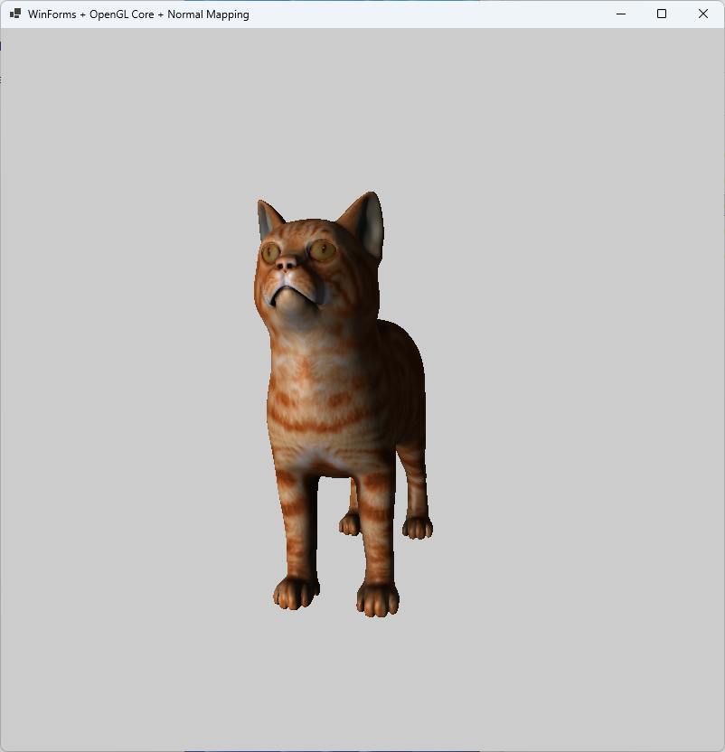

# OBJ Viewer Demo

This is a small demonstration project written in **C# (WinForms)** using **pure OpenGL (via Win32 interop, no external libraries)**.
The goal of the project is to explore low-level graphics programming in .NET and implement a minimal but realistic rendering pipeline.

## Features
- OpenGL context creation without third-party wrappers (3.3 core profile, 4x MSAA, vsync)
- Shader-based rendering (vertex + fragment shaders)
- Textured 3D rendering with Blinn-Phong lighting and a moving light
- Bump mapping from a height map, without tangents (from screen-space derivatives)
- Basic camera controls (rotation, zoom)
- OBJ model loading (Wavefront format) with its material's textures (MTL)
- Indexed vertex buffer / VAO usage
- Depth testing

## Screenshot

## Technical Details
- Language: C# 14 (.NET 10)
- UI: WinForms
- Graphics API: OpenGL 3.3 core profile
- Interop: Win32 (wgl, GDI) through `LibraryImport` and unmanaged function pointers
- No external libraries (no OpenTK, no SharpGL, etc.)

## Controls
- Mouse drag — rotate the model (the turntable stops while you drag)
- Mouse wheel — zoom in/out
- Esc — exit

## Purpose
This project is not intended as a production-ready renderer.
It is a **learning / exploration project**, focused on:
- understanding how OpenGL works under the hood
- working without abstractions
- bridging managed (.NET) and unmanaged (OpenGL/Win32) worlds

## Notes
- The code intentionally avoids helper libraries to keep full control over the pipeline
- OBJ loading is simplified: polygons are split into triangle fans, one material per model, texture map options are ignored
- Designed to be compact and readable rather than feature-complete

## How to Run
1. Open the solution in Visual Studio 2026 (or run `dotnet run` in the project folder)
2. Build and run
3. Make sure your graphics driver supports OpenGL 3.3

## Support

If you found this project interesting or useful, you can support my work:

